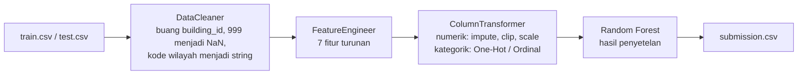

# Structural Damage Classification — Tugas 1 Supervised Machine Learning

Klasifikasi multikelas tingkat kerusakan bangunan (`damage_grade`: Grade 1–5) pasca gempa Gorkha, Nepal (25 April 2015), berdasarkan karakteristik struktural bangunan. Kompetisi: Kaggle — *Structural Damage Classification* ([tautan undangan](https://www.kaggle.com/t/a9196b92680b4492aeb06aeaee94f654)) · Metrik evaluasi: **Macro F1-Score**.

| | |
|---|---|
| **Nama** | `Ghisele Valerin Sharent Milano` |
| **NRP** | `5052241005` |
| **Mata kuliah** | Supervised Machine Learning |

---

## 1. Ringkasan

| Item | Keterangan |
|---|---|
| Data | 533.465 baris latih (17 kolom), 228.629 baris uji (16 kolom); sumber: survei pasca-gempa Central Bureau of Statistics (CBS) Nepal |
| Pendekatan | `Pipeline` scikit-learn: pembersihan data → fitur turunan → `ColumnTransformer` → **Random Forest** hasil penyetelan (tanpa Neural Network) |
| Macro F1 *hold-out* (106.693 bangunan) | **0,5257** (baseline kelas mayoritas: 0,106) |
| Macro F1 validasi silang (5-fold) | 0,4902 ± 0,0035 (subsampel 50.000 baris) |

Temuan utama: lokasi bangunan dan jenis konstruksi merupakan penentu utama tingkat kerusakan. Model paling andal untuk **memprioritaskan** bangunan yang perlu diperiksa, dan kurang andal untuk menentukan grade yang pasti pada kelas menengah (Grade 2–3). Analisis lengkap ada pada [bagian 6](#6-laporan-interpretasi).

---

## 2. Struktur repositori

```
structural-damage-classification/
│
├── README.md
├── .gitignore
├── requirements.txt
├── setup.bat                      # pemasangan environment otomatis (Windows)
│
├── dataset/                          
│   ├── train.csv
│   ├── test.csv
│   ├── sample_submission.csv
│   └── metadata.csv
│
├── notebooks/
│   ├── 01_eda.ipynb               # eksplorasi data
│   ├── 02_modeling.ipynb          # perbandingan model, ablation, tuning, evaluasi, pelatihan akhir
│   └── 03_submission.ipynb        # prediksi, validasi format, pemeriksaan kewajaran
│
├── scripts/
│   ├── __init__.py
│   ├── preprocess.py              # DataCleaner, QuantileClipper, ColumnTransformer, pipeline
│   ├── feature_engineering.py     # FeatureEngineer (7 fitur turunan)
│   ├── train.py                   # registri model, validasi silang, pelatihan, penyimpanan
│   └── predict.py                 # prediksi data uji, validasi dan ekspor submission
│
├── models/
│   ├── pipeline_model_random_forest.pkl         # pipeline lengkap (preprocessing + model)
│   ├── pipeline_model_random_forest_meta.json   # parameter, versi pustaka, waktu pelatihan
│   └── best_params.json                         # hiperparameter hasil penyetelan
│
├── submissions/
│   └── submission.csv             # berkas yang diunggah ke Kaggle
│
└── reports/
    ├── model_comparison.csv
    └── figures/                   # seluruh grafik (lihat bagian 7)
```

| Berkas | Fungsi utama |
|---|---|
| `scripts/preprocess.py` | `DataCleaner` (buang `building_id`, ubah `age_building == 999` menjadi `NaN`, kode wilayah menjadi string); `QuantileClipper` (potong nilai ekstrem); `build_preprocessor` (`ColumnTransformer`); `make_model_pipeline` |
| `scripts/feature_engineering.py` | `FeatureEngineer`: `age_is_unknown`, `age_is_new`, `log_plinth_area`, `area_per_floor`, `height_per_floor`, `n_rc_elements`, `n_mud_elements` |
| `scripts/train.py` | `MODEL_SPECS` (5 kandidat model), `evaluate_cv`, `train_and_save`, `load_model`; dapat dijalankan dari terminal |
| `scripts/predict.py` | `predict_in_chunks`, `build_submission`, `validate_submission`, `run_prediction`; dapat dijalankan dari terminal |

---

## 3. Cara menjalankan

### 3.1 Prasyarat
- Python 3.11 (diuji dengan 3.11.0) dan Git
- Akun Kaggle yang sudah bergabung ke kompetisi dan menerima aturannya (*Join Competition → I Understand and Accept*)

### 3.2 Instalasi

```bash
git clone <URL-REPOSITORI>
cd structural-damage-classification
```

**Windows (otomatis):** jalankan `setup.bat`. Skrip ini membuat folder `venv`, meng-install seluruh paket pada `requirements.txt`, dan mendaftarkan kernel Jupyter bernama **Python (venv)**.

**Manual (semua sistem operasi):**
```bash
python -m venv venv                     # Windows: py -m venv venv
# aktivasi — Windows: venv\Scripts\activate | macOS/Linux: source venv/bin/activate
pip install -r requirements.txt
python -m ipykernel install --user --name structural-damage --display-name "Python (venv)"
```
Jika PowerShell menolak aktivasi karena *execution policy*, jalankan sekali `Set-ExecutionPolicy -Scope CurrentUser RemoteSigned`, atau panggil `venv\Scripts\python.exe` secara langsung tanpa aktivasi.

### 3.3 Mengunduh data
Data **tidak disertakan** pada repositori (berukuran besar dan tunduk pada aturan kompetisi; `dataset/*.csv` terdaftar di `.gitignore`).

- **Melalui web:** buka halaman kompetisi → tab **Data** → **Download All**, lalu ekstrak `train.csv`, `test.csv`, `sample_submission.csv`, dan `metadata.csv` ke folder `dataset/`.
- **Melalui command line** (membutuhkan `kaggle.json`):
  ```bash
  kaggle competitions download -c structural-damage-classification -p dataset
  ```
  Ekstrak berkas zip yang dihasilkan ke dalam folder `dataset/`.

### 3.4 Menjalankan melalui notebook
Pilih kernel **Python (venv)**, kemudian jalankan berurutan (*Run All*):

| Urutan | Notebook | Keluaran |
|---|---|---|
| 1 | `notebooks/01_eda.ipynb` | Grafik EDA pada `reports/figures/` |
| 2 | `notebooks/02_modeling.ipynb` | `models/pipeline_model_*.pkl`, `models/best_params.json`, `reports/model_comparison.csv`, grafik evaluasi |
| 3 | `notebooks/03_submission.ipynb` | `submissions/submission.csv`, grafik pemeriksaan prediksi |

Notebook 02 paling lama karena melatih beberapa model dengan validasi silang, menyetel hiperparameter, dan melatih model akhir pada seluruh data. Waktunya dapat mencapai puluhan menit tergantung perangkat. Parameter eksperimen (`SAMPLE_SIZE`, `N_ITER_SEARCH`, dan lainnya) berada pada sel konfigurasi di bagian awal notebook.

### 3.5 Menjalankan melalui terminal (tanpa notebook)
Jalankan dari **root repositori**:

```bash
python -m scripts.train --list                                  # daftar model kandidat
python -m scripts.train --params-file models/best_params.json   # latih model terbaik dan simpan ke models/
python -m scripts.predict                                       # buat submissions/submission.csv
```

Opsi lain: `python -m scripts.train --model reglog --cv` (model dan validasi silang tertentu), `python -m scripts.predict --model-name random_forest --output submissions/lain.csv`.

Menggunakan model yang sudah tersimpan tanpa pelatihan ulang:

```python
from scripts.train import load_model
model = load_model("models/pipeline_model_random_forest.pkl")
model.predict(X_baru)   # DataFrame dengan kolom yang sama seperti test.csv
```
Berkas `.pkl` terikat pada versi scikit-learn (dicatat pada berkas `_meta.json`) dan hanya boleh dimuat dari sumber tepercaya.

### 3.6 Mengunggah ke Kaggle
Unggah `submissions/submission.csv` melalui halaman kompetisi (**Submit Prediction → Upload Submission File**), atau:
```bash
kaggle competitions submit -c structural-damage-classification -f submissions/submission.csv -m "Random Forest tuned, hold-out Macro F1 0.526"
```
Batas kompetisi: maksimal 5 submission per hari, dan maksimal 2 submission final yang dipilih untuk dinilai.

---

## 4. Pendekatan

### 4.1 Alur kerja



Seluruh langkah berada dalam satu `Pipeline` sehingga parameter yang dipelajari dari data (median, kuantil, kategori) hanya berasal dari data latih pada setiap *fold*. Hal ini mencegah kebocoran data pada validasi silang.

### 4.2 Eksplorasi data (`01_eda.ipynb`)
- **Target tidak seimbang:** Grade 5 ≈ 36%, Grade 1 ≈ 10% (rasio 3,5 : 1). Menebak kelas mayoritas memberi akurasi 0,362 tetapi Macro F1 hanya **0,106**; angka ini menjadi batas bawah.
- **Nilai tidak wajar:** `age_building = 999` pada 2.198 baris (0,41%) diduga kode "tidak diketahui" (tidak didokumentasikan pada `metadata.csv`); `height_ft_pre_eq ≥ 50` ft pada 793 baris; `plinth_area_sq_ft` berekor kanan panjang.
- **Asosiasi fitur kategorik dengan target** (uji Chi-square, χ²/df): `roof_type` ≈ 10.980, `foundation_type` ≈ 8.738, `other_floor_type` ≈ 8.358, `ground_floor_type` ≈ 6.734, `district_id` ≈ 4.828, `superstructure` ≈ 4.788.
- **Kode wilayah:** `district_id` (11 level), `vdcmun_id` (110), `ward_id` (945) bersifat nominal dan hierarkis; seluruh ward pada data uji ada pada data latih.
- **Tidak ada *distribution shift*** antara train dan test (statistik KS D ≤ 0,003).
- **Duplikat fitur:** 34.062 baris (≈ 6,4%); tidak dihapus karena wajar terjadi pada bangunan sejenis.
- `superstructure` pada data merupakan ringkasan satu label dari 11 flag material pada metadata.

### 4.3 Preprocessing dan fitur turunan

| Kelompok | Perlakuan |
|---|---|
| Numerik (`count_floors_pre_eq`, `age_building`, `height_ft_pre_eq`, fitur turunan numerik) | `SimpleImputer(median)` → `QuantileClipper` (kuantil 0,5%–99,5%) → `StandardScaler` (hanya model linear) |
| Biner (`age_is_unknown`, `age_is_new`) | diteruskan apa adanya |
| Kategorik (8 kolom bangunan, `district_id`, `vdcmun_id`) | `OneHotEncoder` (model linear) atau `OrdinalEncoder` (model pohon) |
| `ward_id` (945 level) | One-Hot dengan `min_frequency` (linear) atau Ordinal (pohon) |

| Fitur turunan | Arti |
|---|---|
| `age_is_unknown` | 1 jika umur tidak diketahui (`999`) |
| `age_is_new` | 1 jika `age_building == 0` |
| `log_plinth_area` | `log(1 + luas dasar)` |
| `area_per_floor`, `height_per_floor` | luas dasar dan tinggi dibagi jumlah lantai |
| `n_rc_elements`, `n_mud_elements` | jumlah elemen (fondasi, atap, lantai, superstruktur) berbahan beton bertulang / lumpur |

### 4.4 Pemodelan dan protokol evaluasi (`02_modeling.ipynb`)
- **Pembagian data (berstrata):** *hold-out* 20% (106.693 baris) yang tidak disentuh selama pemilihan model; subsampel pengembangan 50.000 baris dari 80% sisanya untuk validasi silang dan tuning; model akhir dilatih pada seluruh 533.465 baris.
- **Kandidat (tanpa Neural Network):** Logistic Regression (multinomial, One-vs-Rest, One-vs-One), Random Forest, HistGradientBoosting. Seluruhnya memakai bobot kelas seimbang.
- **Validasi:** `StratifiedKFold` 5-fold dengan Macro F1; perbandingan antar-model memakai fold yang sama.
- **Penyetelan:** `RandomizedSearchCV` (10 kombinasi, 3-fold) pada model terbaik, lalu dievaluasi ulang dengan 5-fold dan dipakai hanya bila lebih baik daripada konfigurasi bawaan.
- **Kapasitas Random Forest dibatasi** (`min_samples_leaf` sebagai fraksi data) agar ukuran berkas model tetap di bawah 100 MB (hasil akhir: 79 MB).

### 4.5 Kesesuaian dengan aturan tugas

| Aturan | Pemenuhan |
|---|---|
| Struktur repositori sesuai contoh | Bagian 2 |
| Tidak menggunakan Neural Network | Kandidat: regresi logistik, Random Forest, HistGradientBoosting |
| Pipeline dan `ColumnTransformer` pada preprocessing, training, dan tuning | `scripts/preprocess.py`, `scripts/train.py`; tuning dilakukan pada pipeline lengkap |
| Docstring pada setiap fungsi/kelas `.py` | Seluruh fungsi dan kelas pada `scripts/` berdocstring |
| `.gitignore` mengabaikan `dataset/*.csv` | Ya |
| Cara unduh data didokumentasikan | Bagian 3.3 |
| Laporan interpretasi pada README | Bagian 6 |

---

## 5. Hasil

### 5.1 Perbandingan model (validasi silang 5-fold, subsampel 50.000 baris)

| Model | Macro F1 (rata-rata ± simpangan baku) | Akurasi | Waktu latih per fold (detik) |
|---|---|---|---|
| **Random Forest** | **0,4784 ± 0,0015** | 0,520 | 8,7 |
| HistGradientBoosting | 0,4696 ± 0,0056 | 0,508 | 8,1 |
| Logistic Regression (multinomial) | 0,4507 ± 0,0038 | 0,491 | 6,2 |
| Logistic Regression (One-vs-One) | 0,4498 ± 0,0032 | 0,491 | 3,3 |
| Logistic Regression (One-vs-Rest) | 0,4451 ± 0,0043 | 0,495 | 5,2 |
| *Baseline kelas mayoritas* | *0,106* | — | — |


### 5.2 Ablation study: manfaat fitur turunan

| Model | Tanpa fitur turunan | Dengan fitur turunan | Selisih rata-rata | Simpangan baku selisih | Fold membaik |
|---|---|---|---|---|---|
| Logistic Regression (multinomial) | 0,4492 | 0,4507 | +0,0015 | 0,0011 | 5 dari 5 |
| HistGradientBoosting | 0,4697 | 0,4696 | −0,0001 | 0,0046 | 2 dari 5 |
| Random Forest | 0,4797 | 0,4784 | −0,0014 | 0,0027 | 1 dari 5 |

Fitur turunan hanya membantu model linear (dan peningkatannya sangat kecil). Pada model berbasis pohon, termasuk Random Forest yang menjadi model akhir, manfaat fitur turunan tidak terbukti. Selisih −0,0014 pada Random Forest lebih kecil daripada simpangan bakunya, sehingga tidak dapat disimpulkan bahwa fitur turunan merugikan. Fitur tersebut dipertahankan karena model telah dilatih dan dievaluasi dengan fitur tersebut.

### 5.3 Penyetelan hiperparameter (Random Forest)

| Konfigurasi | Macro F1 (5-fold) |
|---|---|
| Bawaan | 0,4784 |
| **Hasil penyetelan** | **0,4902** (± 0,0035) |

Parameter terpilih: `n_estimators=150`, `max_depth=30`, `min_samples_leaf=0,0001`, `max_features=0,5`. Peningkatan sekitar 0,012 (±3 simpangan baku) bermakna secara praktis.

### 5.4 Evaluasi pada data *hold-out* (106.693 bangunan)

**Macro F1 = 0,5257** · akurasi = 0,556 · F1 rata-rata berbobot = 0,560

| Kelas | Presisi | Recall | F1 | Jumlah |
|---|---|---|---|---|
| Grade 1 | 0,541 | 0,777 | 0,638 | 11.034 |
| Grade 2 | 0,342 | 0,397 | 0,367 | 12.216 |
| Grade 3 | 0,409 | 0,410 | 0,409 | 19.098 |
| Grade 4 | 0,511 | 0,489 | 0,500 | 25.738 |
| Grade 5 | 0,776 | 0,661 | 0,713 | 38.607 |

Matriks konfusi (persentase per kelas aktual, baris = aktual, kolom = prediksi):

| Aktual \ Prediksi | Grade 1 | Grade 2 | Grade 3 | Grade 4 | Grade 5 |
|---|---|---|---|---|---|
| **Grade 1** | **78%** | 15% | 4% | 2% | 1% |
| **Grade 2** | 29% | **40%** | 20% | 7% | 4% |
| **Grade 3** | 10% | 20% | **41%** | 19% | 9% |
| **Grade 4** | 3% | 8% | 20% | **49%** | 20% |
| **Grade 5** | 2% | 4% | 9% | 19% | **66%** |

Sebanyak 68,9% dari seluruh kesalahan prediksi hanya berselisih satu tingkat grade.


### 5.5 Skor kompetisi Kaggle

| | Skor |
|---|---|
| *Public score* | `0.52501` |
| *Private score* | `[TERLIHAT SETELAH KOMPETISI BERAKHIR]` |
| Acuan (Macro F1 *hold-out*) | 0,5257 |


### 5.6 Pemeriksaan kewajaran submission (`03_submission.ipynb`)
Submission lolos seluruh validasi format: kolom identik dengan `sample_submission.csv`, 228.629 baris, `building_id` unik dan berurutan sama, tanpa nilai kosong, dan seluruh label sah.

| Kelas | Data latih (aktual) | Prediksi pada test | Diharapkan dari *hold-out*\* |
|---|---|---|---|
| Grade 1 | 10,3% | 15,0% | 14,9% |
| Grade 2 | 11,4% | 13,5% | 13,3% |
| Grade 3 | 17,9% | 17,8% | 17,9% |
| Grade 4 | 24,1% | 22,8% | 23,1% |
| Grade 5 | 36,2% | 30,9% | 30,8% |

\* proporsi aktual × recall ÷ presisi kelas tersebut pada *hold-out*.


---

## 6. Laporan interpretasi

### 6.1 Apa yang menentukan tingkat kerusakan?
- **Jenis konstruksi** sangat diskriminatif pada EDA: bangunan beton bertulang (RC) hampir seluruhnya mengalami kerusakan ringan, sedangkan bangunan berfondasi *mud mortar* mayoritas mengalami kerusakan berat.
- **Wilayah** juga sangat menentukan: porsi bangunan Grade 4–5 antardistrik berkisar sekitar 20% (distrik 31) hingga sekitar 89–93% (distrik 29 dan 23).
- **Menurut model**, *permutation importance* menempatkan kolom wilayah paling atas (`ward_id` 0,117; `vdcmun_id` 0,057; `district_id` 0,021), diikuti tinggi bangunan (0,023), jumlah lantai (0,012), dan umur (0,010). Kolom jenis konstruksi tampak kecil secara individual (0,002–0,011) karena saling berkorelasi sehingga kepentingannya terbagi; hal ini **tidak** berarti konstruksi tidak penting. Pengujian gabungan (mengacak seluruh kolom konstruksi sekaligus) belum dilakukan.
- Kode wilayah bersifat hierarkis, sehingga urutan kode pada *encoding* ordinal mencerminkan kedekatan geografis. Tingginya kepentingan `ward_id` kemungkinan sebagian mencerminkan pola lokal (jarak ke episentrum, jenis tanah), dan hanya berlaku untuk wilayah yang ada pada data latih (seluruh ward data uji memang ada pada data latih).
- Seluruh hubungan ini bersifat asosiasi, bukan kausalitas: bangunan *mud mortar* juga cenderung lebih tua dan terkonsentrasi di distrik tertentu (*confounding*).


### 6.2 Seberapa baik performa model?
- Macro F1 *hold-out* 0,526 sekitar **lima kali** baseline (0,106), tetapi belum tinggi secara absolut.
- **Kelas ekstrem paling mudah** (Grade 1 F1 0,64; Grade 5 F1 0,71), **kelas menengah paling sulit** (Grade 2 F1 0,37; Grade 3 F1 0,41). Wajar untuk target ordinal: batas antara grade yang bersebelahan bersifat samar.
- Recall Grade 1 (0,78) jauh lebih tinggi daripada presisinya (0,54): bobot kelas seimbang membuat model terlalu sering memprediksi kelas minoritas.
- Skor *hold-out* (0,526) **lebih tinggi** daripada validasi silang (0,490). Hal ini bukan tanda *overfitting*, melainkan karena model *hold-out* dilatih pada 427 ribu baris, sedangkan setiap *fold* validasi silang hanya sekitar 40 ribu baris; performa masih meningkat seiring bertambahnya data.
- Parameter terbaik pada penyetelan berada pada **batas** ruang pencarian (kapasitas tertinggi yang ditawarkan, dibatasi demi ukuran berkas), sehingga skor mungkin masih dapat dinaikkan dengan kapasitas lebih besar.

### 6.3 Apakah prediksi pada data uji wajar?
- **Distribusi kelas konsisten.** Proporsi prediksi pada data uji sangat dekat dengan proporsi yang diharapkan dari presisi dan recall pada *hold-out* (selisih ≤ 0,3 poin persen). Ini menunjukkan pipeline berperilaku konsisten pada data uji.
- **Kerusakan berat cenderung diremehkan.** Total prediksi Grade 4–5 adalah 53,7%, lebih rendah daripada 60,3% pada data latih. Pada *hold-out*, sekitar 15% bangunan Grade 5 diprediksi Grade 1–3.
- **Pola per distrik mengikuti data latih** (korelasi Pearson 0,997), tetapi korelasi hanya mengukur urutan, bukan kesesuaian nilai. Prediksi cenderung lebih ekstrem daripada aktualnya: pada distrik berkerusakan rendah (12, 20, 31), porsi Grade 4–5 prediksi jauh lebih kecil daripada aktual. Penyebabnya adalah pemilihan kelas dengan probabilitas tertinggi (*argmax*): kelas yang jarang pada suatu wilayah hampir tidak pernah terpilih.
- **Keyakinan paling rendah pada kelas menengah** (rata-rata probabilitas tertinggi: Grade 2 = 0,41; Grade 3 = 0,41; dibandingkan Grade 1 = 0,58 dan Grade 5 = 0,67), sejalan dengan F1 *hold-out*. Pada banyak bangunan, dua kelas bersebelahan memiliki probabilitas yang berdekatan (misalnya Grade 4 dan Grade 5), sehingga pilihan akhir sensitif terhadap selisih kecil.


### 6.4 Implikasi bagi pengambil keputusan
- Model lebih tepat dipakai untuk **memprioritaskan inspeksi dan alokasi dana rekonstruksi** daripada menetapkan grade kerusakan yang pasti pada setiap bangunan. Kesalahan terbanyak (68,9%) hanya berselisih satu grade.
- Perkuatan (*retrofit*) sebaiknya memprioritaskan bangunan berfondasi *mud mortar* di distrik berisiko tinggi (distrik 23, 29, 28, dan 22 memiliki porsi Grade 4–5 sekitar 80–93%).
- Apabila kegagalan yang paling mahal adalah **melewatkan bangunan yang rusak berat**, aturan keputusan perlu disesuaikan (misalnya menurunkan ambang probabilitas untuk Grade 4–5), dengan konsekuensi lebih banyak bangunan yang diperiksa tanpa perlu.

### 6.5 Limitasi
- Perbandingan model dan penyetelan memakai **subsampel 50.000 baris**; peringkat model pada data penuh dapat berbeda, terutama untuk model berkapasitas tinggi.
- *Hold-out* masih memuat baris kembar dari data latih (duplikat fitur ≈ 6,4%), sehingga skornya dapat sedikit lebih optimistis daripada skor pada data uji.
- *Ablation study* dilakukan dengan hiperparameter bawaan pada subsampel; efek pada model hasil penyetelan dan data penuh tidak diuji.
- Struktur **ordinal** target (Grade 1 < … < Grade 5) tidak dimanfaatkan; model memperlakukan kelas secara nominal.
- Bobot kelas seimbang tidak identik dengan pengoptimal Macro F1.
- Encoding ordinal pada `ward_id` untuk model pohon bersifat arbitrer.
- Anggapan bahwa `age_building = 999` berarti "tidak diketahui" berasal dari pola data, bukan dari dokumentasi panitia.
- Validasi acak mengukur generalisasi pada wilayah yang sama dengan data latih; kemampuan generalisasi ke wilayah yang sepenuhnya baru tidak diuji.

### 6.6 Pengembangan lanjutan
1. Menyesuaikan **aturan keputusan** (ambang probabilitas per kelas atau nilai harapan grade) untuk meningkatkan Macro F1 dan mengurangi peremehan kerusakan berat.
2. Mencoba **pendekatan ordinal** (misalnya regresi dengan *threshold tuning*).
3. Menguji **kepentingan fitur gabungan** untuk kelompok fitur konstruksi.
4. Memperluas ruang pencarian hiperparameter dengan tetap memperhatikan ukuran berkas model.
5. Menguji generalisasi geografis dengan validasi silang berkelompok (`GroupKFold` berdasarkan wilayah).

---

## 7. Daftar visualisasi (`reports/figures/`)

| Berkas | Isi | Dihasilkan oleh |
|---|---|---|
| `01_target_distribution.png` | Distribusi `damage_grade` | `01_eda.ipynb` |
| `02_numeric_by_grade.png` | Fitur numerik per grade | `01_eda.ipynb` |
| `03_categorical_grade_mix.png` | Komposisi grade per kategori fitur | `01_eda.ipynb` |
| `04_district_grade_mix.png` | Komposisi grade per distrik | `01_eda.ipynb` |
| `05_chi_square_target.png` | Kekuatan asosiasi fitur kategorik (χ²/df) | `01_eda.ipynb` |
| `07_model_comparison.png` | Macro F1 validasi silang per algoritma | `02_modeling.ipynb` |
| `08_confusion_matrix_holdout.png` | Matriks konfusi dan F1 per kelas (*hold-out*) | `02_modeling.ipynb` |
| `09_permutation_importance.png` | **Feature importance** (*permutation importance*) | `02_modeling.ipynb` |
| `10_prediction_class_distribution.png` | Proporsi kelas: latih vs prediksi | `03_submission.ipynb` |
| `11_prediction_district_consistency.png` | Porsi Grade 4–5 per distrik: aktual vs prediksi | `03_submission.ipynb` |
| `12_prediction_confidence.png` | Keyakinan prediksi per kelas | `03_submission.ipynb` |

Seluruh grafik dibuat ulang setiap kali notebook terkait dijalankan.

---

## 8. Reproduksibilitas
- Seluruh proses acak memakai `SEED = 42` (pembagian data, validasi silang, model, dan pencarian hiperparameter).
- Versi pustaka saat pelatihan dicatat pada `models/pipeline_model_random_forest_meta.json`; `scripts/predict.py` memberi peringatan bila versi scikit-learn berbeda.
- Hasil numerik dapat sedikit berbeda antar-perangkat atau antar-versi pustaka.

## 9. Sumber data
Data berasal dari kompetisi Kaggle *Structural Damage Classification* (survei pasca-gempa CBS Nepal) dan tunduk pada aturan kompetisi. Data tidak didistribusikan ulang pada repositori ini.