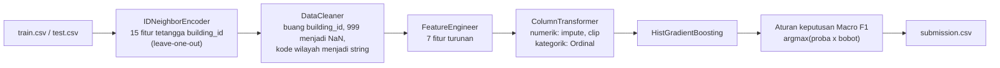
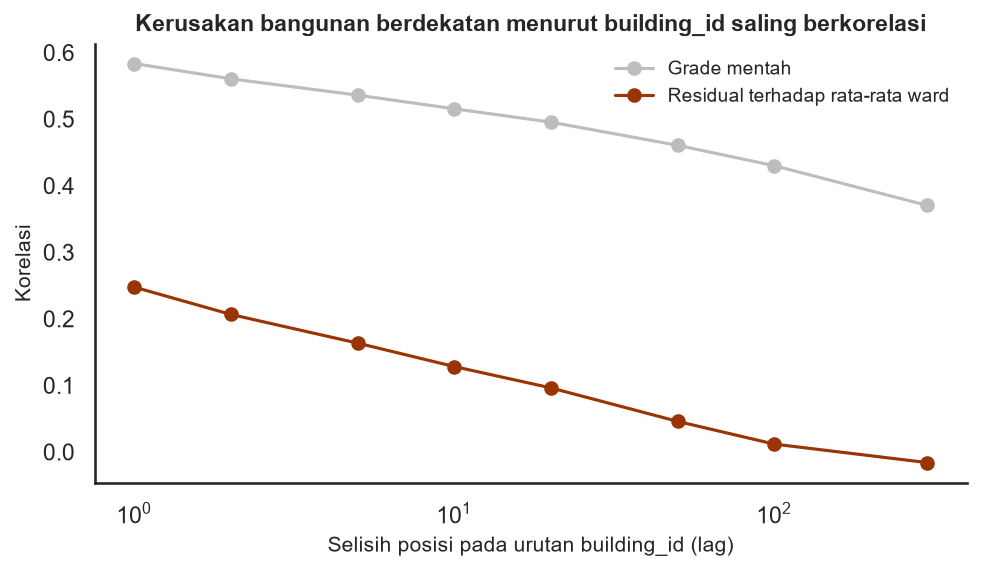
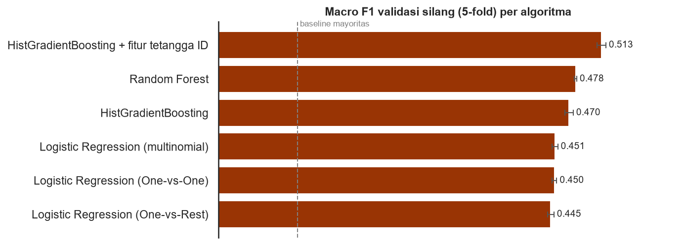
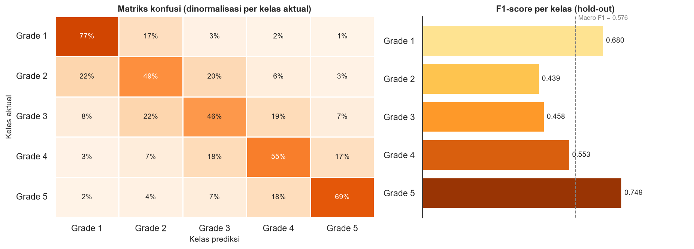
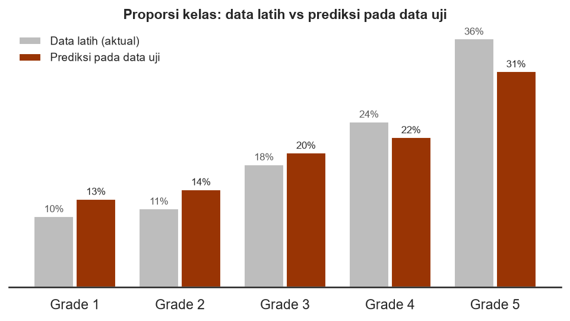
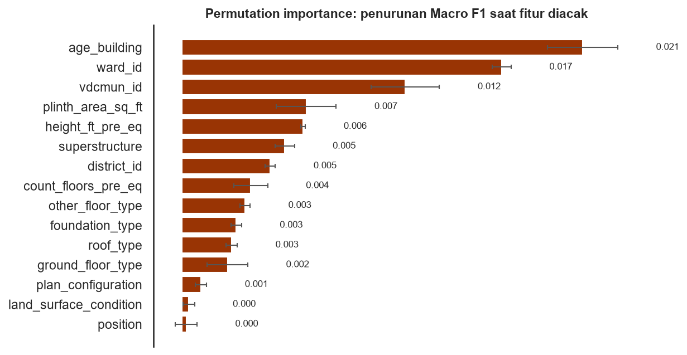
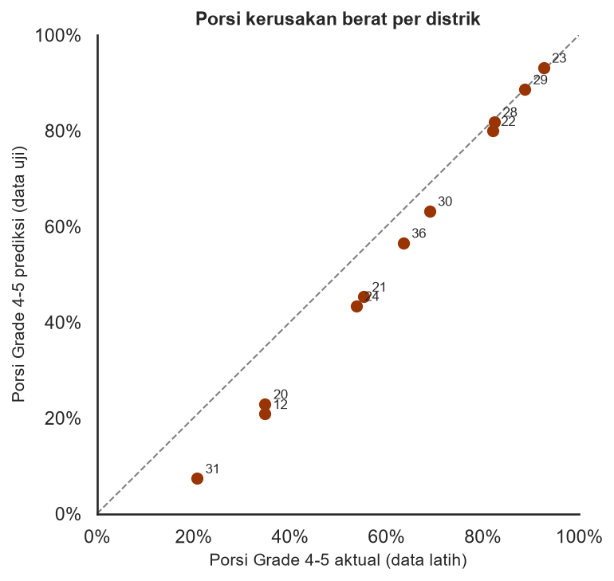
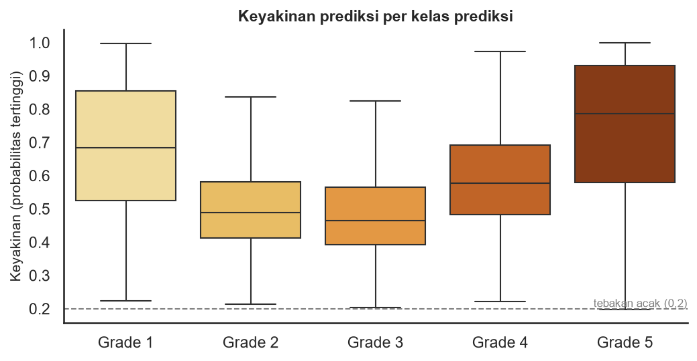

# Structural Damage Classification — Tugas 1 Supervised Machine Learning

Klasifikasi multikelas tingkat kerusakan bangunan (`damage_grade`: Grade 1–5) pasca gempa Gorkha, Nepal (25 April 2015), berdasarkan karakteristik struktural bangunan. Kompetisi: Kaggle — *Structural Damage Classification* ([tautan undangan](https://www.kaggle.com/t/a9196b92680b4492aeb06aeaee94f654)) · Metrik evaluasi: **Macro F1-Score**.

| | |
|---|---|
| **Nama** | `Ghisele Valerin Sharent Milano` |
| **NRP** | `5052241005` |
| **Mata kuliah** | Supervised Machine Learning |

---

## 1. Ringkasan

| Item | Keterangan |
|---|---|
| Data | 533.465 baris latih (17 kolom), 228.629 baris uji (16 kolom); sumber: survei pasca-gempa Central Bureau of Statistics (CBS) Nepal |
| Pendekatan | `Pipeline` scikit-learn: fitur tetangga `building_id` → pembersihan data → fitur turunan → `ColumnTransformer` → **HistGradientBoosting** → aturan keputusan Macro F1 (tanpa Neural Network) |
| Macro F1 *hold-out* (106.693 bangunan) | **0,5758** (`argmax`); 0,5787 dengan bobot keputusan (estimasi *cross-fit*, lihat 5.4) · baseline kelas mayoritas: 0,106 |
| Macro F1 validasi silang (5-fold) | 0,5128 ± 0,0060 (subsampel 50.000 baris) |
| Versi sebelumnya (Random Forest tanpa fitur tetangga) | *hold-out* 0,5257 · *public score* Kaggle 0,52501 |

Temuan utama: lokasi bangunan dan jenis konstruksi merupakan penentu utama tingkat kerusakan. Peningkatan terbesar dari versi sebelumnya (±0,526 menjadi ±0,576) berasal dari **fitur tetangga berbasis `building_id`**: bangunan dengan ID bersebelahan cenderung rusak serupa, bahkan setelah efek rata-rata ward dikeluarkan (bagian 4.2). Fitur ini sah menurut aturan kompetisi dan tidak memakai label data uji, tetapi memanfaatkan struktur urutan survei, bukan sifat fisik bangunan; catatan lengkapnya ada pada [bagian 6.5](#65-limitasi). Model paling andal untuk **memprioritaskan** bangunan yang perlu diperiksa, dan kurang andal untuk menentukan grade yang pasti pada kelas menengah (Grade 2–3). Analisis lengkap ada pada [bagian 6](#6-laporan-interpretasi).

---

## 2. Struktur repositori

```
structural-damage-classification/
│
├── README.md
├── .gitignore
├── requirements.txt
├── setup.bat                      # pemasangan environment otomatis (Windows)
│
├── data/                          
│   ├── train.csv
│   ├── test.csv
│   ├── sample_submission.csv
│   └── metadata.csv
│
├── notebooks/
│   ├── 01_eda.ipynb               # eksplorasi data
│   ├── 02_modelling.ipynb         # perbandingan model, ablation, tuning, evaluasi, bobot keputusan, pelatihan akhir
│   └── 03_submission.ipynb        # prediksi, validasi format, pemeriksaan kewajaran
│
├── scripts/
│   ├── __init__.py
│   ├── preprocess.py              # DataCleaner, QuantileClipper, ColumnTransformer, pipeline
│   ├── feature_engineering.py     # FeatureEngineer (7 fitur turunan), IDNeighborEncoder (fitur tetangga)
│   ├── train.py                   # registri model, validasi silang, pelatihan, penyimpanan
│   └── predict.py                 # prediksi data uji, validasi dan ekspor submission
│
├── models/
│   ├── pipeline_model_hist_gb_nbr.pkl           # pipeline lengkap (preprocessing + model), ±13,5 MB
│   ├── pipeline_model_hist_gb_nbr_meta.json     # parameter, versi pustaka, waktu pelatihan
│   ├── best_params.json                         # model terpilih dan hiperparameternya
│   └── decision_weights.json                    # pengali probabilitas per kelas (aturan keputusan Macro F1)
│
├── submissions/
│   └── submission.csv             # berkas yang diunggah ke Kaggle
│
└── reports/
    ├── model_comparison.csv
    └── figures/                   # seluruh grafik (lihat bagian 7)
```

| Berkas | Fungsi utama |
|---|---|
| `scripts/preprocess.py` | `DataCleaner` (buang `building_id` setelah dipakai `IDNeighborEncoder`, ubah `age_building == 999` menjadi `NaN`, kode wilayah menjadi string); `QuantileClipper` (potong nilai ekstrem); `build_preprocessor` (`ColumnTransformer`); `make_model_pipeline` |
| `scripts/feature_engineering.py` | `FeatureEngineer`: `age_is_unknown`, `age_is_new`, `log_plinth_area`, `area_per_floor`, `height_per_floor`, `n_rc_elements`, `n_mud_elements`; `IDNeighborEncoder`: 15 fitur dari label bangunan berlabel dengan `building_id` berdekatan (*leave-one-out*) |
| `scripts/train.py` | `MODEL_SPECS` (6 kandidat model), `evaluate_cv`, `train_and_save`, `load_model`, `tune_class_weights`, `fit_decision_weights`; dapat dijalankan dari terminal |
| `scripts/predict.py` | `predict_in_chunks` (dengan bobot keputusan), `to_kaggle_labels`, `build_submission`, `validate_submission`, `run_prediction`; dapat dijalankan dari terminal |

---

## 3. Cara menjalankan

### 3.1 Prasyarat
- Python 3.11 (diuji dengan 3.11.0) dan Git
- Akun Kaggle yang sudah bergabung ke kompetisi dan menerima aturannya (*Join Competition → I Understand and Accept*)

### 3.2 Instalasi

```bash
git clone <https://github.com/gisellsjians/Structural-Damage-Classification.git>
cd structural-damage-classification
```

**Windows (otomatis):** jalankan `setup.bat`. Skrip ini membuat folder `venv`, meng-install seluruh paket pada `requirements.txt`, dan mendaftarkan kernel Jupyter bernama **Python (venv)**.

**Manual (semua sistem operasi):**
```bash
python -m venv venv                     # Windows: py -m venv venv
# aktivasi — Windows: venv\Scripts\activate | macOS/Linux: source venv/bin/activate
pip install -r requirements.txt
python -m ipykernel install --user --name structural-damage --display-name "Python (venv)"
```
Jika PowerShell menolak aktivasi karena *execution policy*, jalankan sekali `Set-ExecutionPolicy -Scope CurrentUser RemoteSigned`, atau panggil `venv\Scripts\python.exe` secara langsung tanpa aktivasi.

### 3.3 Mengunduh data
Data **tidak disertakan** pada repositori (berukuran besar dan tunduk pada aturan kompetisi; `data/*.csv` terdaftar di `.gitignore`).

- **Melalui web:** buka halaman kompetisi → tab **Data** → **Download All**, lalu ekstrak `train.csv`, `test.csv`, `sample_submission.csv`, dan `metadata.csv` ke folder `data/`.
- **Melalui command line** (membutuhkan `kaggle.json`):
  ```bash
  kaggle competitions download -c structural-damage-classification -p dataset
  ```
  Ekstrak berkas zip yang dihasilkan ke dalam folder `data/`.

### 3.4 Menjalankan melalui notebook
Pilih kernel **Python (venv)**, kemudian jalankan berurutan (*Run All*):

| Urutan | Notebook | Keluaran |
|---|---|---|
| 1 | `notebooks/01_eda.ipynb` | Grafik EDA pada `reports/figures/` |
| 2 | `notebooks/02_modelling.ipynb` | `models/pipeline_model_*.pkl`, `models/best_params.json`, `models/decision_weights.json`, `reports/model_comparison.csv`, grafik evaluasi |
| 3 | `notebooks/03_submission.ipynb` | `submissions/submission.csv`, grafik pemeriksaan prediksi |

Notebook 02 paling lama karena melatih beberapa model dengan validasi silang, menyetel hiperparameter, dan melatih model akhir pada seluruh data. Waktunya dapat mencapai puluhan menit tergantung perangkat. Parameter eksperimen (`SAMPLE_SIZE`, `N_ITER_SEARCH`, dan lainnya) berada pada sel konfigurasi di bagian awal notebook.

### 3.5 Menjalankan melalui terminal (tanpa notebook)
Jalankan dari **root repositori**:

```bash
python -m scripts.train --list                                  # daftar model kandidat
python -m scripts.train --params-file models/best_params.json   # latih model terbaik dan simpan ke models/
python -m scripts.train --params-file models/best_params.json --tune-weights   # + setel bobot keputusan pada hold-out 20%
python -m scripts.predict                                       # buat submissions/submission.csv (label angka 1-5)
```

Opsi lain: `python -m scripts.train --model reglog --cv` (model dan validasi silang tertentu), `python -m scripts.predict --model-name hist_gb_nbr --output submissions/lain.csv`, `python -m scripts.predict --no-weights` (tanpa bobot keputusan).

Menggunakan model yang sudah tersimpan tanpa pelatihan ulang:

```python
from scripts.train import load_model
model = load_model("models/pipeline_model_hist_gb_nbr.pkl")
model.predict(X_baru)   # DataFrame dengan kolom yang sama seperti test.csv
```
Berkas `.pkl` terikat pada versi scikit-learn (dicatat pada berkas `_meta.json`) dan hanya boleh dimuat dari sumber tepercaya.

### 3.6 Mengunggah ke Kaggle
Unggah `submissions/submission.csv` melalui halaman kompetisi (**Submit Prediction → Upload Submission File**), atau:
```bash
kaggle competitions submit -c structural-damage-classification -f submissions/submission.csv -m "HistGradientBoosting + fitur tetangga ID, hold-out Macro F1 0.576"
```
**Format label:** `sample_submission.csv` memakai teks `Grade n`, tetapi evaluator Kaggle membaca `damage_grade` sebagai **angka 1–5**; label teks menyebabkan galat *"The input string 'Grade' was not in a correct format"*. Karena itu `scripts/predict.py` menulis `submission.csv` dengan label angka (`to_kaggle_labels`).
Batas kompetisi: maksimal 5 submission per hari, dan maksimal 2 submission final yang dipilih untuk dinilai.

---

## 4. Pendekatan

### 4.1 Alur kerja



Seluruh langkah berada dalam satu `Pipeline` sehingga parameter yang dipelajari dari data (median, kuantil, kategori, dan label tetangga) hanya berasal dari data latih pada setiap *fold*. Hal ini mencegah kebocoran data pada validasi silang. Pada `IDNeighborEncoder`, label sebuah baris latih **dikeluarkan dari fitur tetangganya sendiri** (*leave-one-out*); hal ini diuji secara langsung: mengganti label sebuah baris tidak mengubah fiturnya, sedangkan mengganti label tetangganya mengubahnya.

### 4.2 Eksplorasi data (`01_eda.ipynb`)
- **Target tidak seimbang:** Grade 5 ≈ 36%, Grade 1 ≈ 10% (rasio 3,5 : 1). Menebak kelas mayoritas memberi akurasi 0,362 tetapi Macro F1 hanya **0,106**; angka ini menjadi batas bawah.
- **Nilai tidak wajar:** `age_building = 999` pada 2.198 baris (0,41%) diduga kode "tidak diketahui" (tidak didokumentasikan pada `metadata.csv`); `height_ft_pre_eq ≥ 50` ft pada 793 baris; `plinth_area_sq_ft` berekor kanan panjang.
- **Asosiasi fitur kategorik dengan target** (uji Chi-square, χ²/df): `roof_type` ≈ 10.980, `foundation_type` ≈ 8.738, `other_floor_type` ≈ 8.358, `ground_floor_type` ≈ 6.734, `district_id` ≈ 4.828, `superstructure` ≈ 4.788.
- **Kode wilayah:** `district_id` (11 level), `vdcmun_id` (110), `ward_id` (945) bersifat nominal dan hierarkis; seluruh ward pada data uji ada pada data latih.
- **Tidak ada *distribution shift*** antara train dan test (statistik KS D ≤ 0,003).
- **Duplikat fitur:** 34.062 baris (≈ 6,4%); tidak dihapus karena wajar terjadi pada bangunan sejenis.
- **Struktur `building_id` (bagian 9 notebook 01):** setelah data latih diurutkan menurut `building_id`, korelasi grade dua bangunan bersebelahan ≈ 0,58, dan ≈ 0,25 setelah dikurangi rata-rata ward-nya (0,21 pada selisih 2 posisi, 0,10 pada 10, 0,01 pada 100 posisi). Baris train dan test saling berselang pada urutan ID (70% : 30%), sehingga hampir setiap bangunan uji punya tetangga berlabel. Artinya `building_id` menyimpan informasi lokasi yang lebih halus daripada `ward_id`.
- `superstructure` pada data merupakan ringkasan satu label dari 11 flag material pada metadata.



### 4.3 Preprocessing dan fitur turunan

| Kelompok | Perlakuan |
|---|---|
| Numerik (`count_floors_pre_eq`, `age_building`, `height_ft_pre_eq`, fitur turunan numerik) | `SimpleImputer(median)` → `QuantileClipper` (kuantil 0,5%–99,5%) → `StandardScaler` (hanya model linear) |
| Biner (`age_is_unknown`, `age_is_new`) | diteruskan apa adanya |
| Kategorik (8 kolom bangunan, `district_id`, `vdcmun_id`) | `OneHotEncoder` (model linear) atau `OrdinalEncoder` (model pohon) |
| `ward_id` (945 level) | One-Hot dengan `min_frequency` (linear) atau Ordinal (pohon) |
| Fitur tetangga (15 kolom, hanya `hist_gb_nbr`) | `SimpleImputer(median)` (semua terisi; hanya pengaman) |

| Fitur turunan | Arti |
|---|---|
| `age_is_unknown` | 1 jika umur tidak diketahui (`999`) |
| `age_is_new` | 1 jika `age_building == 0` |
| `log_plinth_area` | `log(1 + luas dasar)` |
| `area_per_floor`, `height_per_floor` | luas dasar dan tinggi dibagi jumlah lantai |
| `n_rc_elements`, `n_mud_elements` | jumlah elemen (fondasi, atap, lantai, superstruktur) berbahan beton bertulang / lumpur |

| Fitur tetangga (`IDNeighborEncoder`) | Arti |
|---|---|
| `nbr_mean_w{1,3,8,25,60,150}` | rata-rata grade `2w` bangunan berlabel terdekat menurut urutan `building_id` (`w` di tiap sisi) |
| `nbr_p{1..5}_w5` | proporsi tiap kelas pada 10 bangunan berlabel terdekat |
| `nbr_prev_grade`, `nbr_next_grade` | grade tetangga langsung (sebelum dan sesudah) |
| `nbr_log_gap_prev`, `nbr_log_gap_next` | log selisih ID ke tetangga langsung (proxy kerapatan pendataan) |

### 4.4 Pemodelan dan protokol evaluasi (`02_modelling.ipynb`)
- **Pembagian data (berstrata):** *hold-out* 20% (106.693 baris) yang tidak disentuh selama pemilihan model; subsampel pengembangan 50.000 baris dari 80% sisanya untuk validasi silang dan tuning; model akhir dilatih pada seluruh 533.465 baris.
- **Kandidat (tanpa Neural Network):** Logistic Regression (multinomial, One-vs-Rest, One-vs-One), Random Forest, HistGradientBoosting, dan HistGradientBoosting + fitur tetangga ID. Seluruhnya memakai bobot kelas seimbang.
- **Validasi:** `StratifiedKFold` 5-fold dengan Macro F1; perbandingan antar-model memakai fold yang sama.
- **Penyetelan:** `RandomizedSearchCV` (10 kombinasi, 3-fold) pada model terbaik, lalu dievaluasi ulang dengan 5-fold dan dipakai hanya bila lebih baik daripada konfigurasi bawaan. Pada model akhir, penyetelan **tidak** mengalahkan konfigurasi bawaan (0,5112 vs 0,5128), sehingga konfigurasi bawaan dipakai.
- **Aturan keputusan Macro F1:** pengali probabilitas per kelas disetel pada probabilitas *hold-out* (`tune_class_weights`), dengan estimasi *cross-fit* (setel pada separuh *hold-out*, uji pada separuh lainnya).
- **Ukuran model:** 13,5 MB (jauh di bawah batas 100 MB GitHub).

### 4.5 Kesesuaian dengan aturan tugas

| Aturan | Pemenuhan |
|---|---|
| Struktur repositori sesuai contoh | Bagian 2 |
| Tidak menggunakan Neural Network | Kandidat: regresi logistik, Random Forest, HistGradientBoosting (dengan dan tanpa fitur tetangga) |
| Pipeline dan `ColumnTransformer` pada preprocessing, training, dan tuning | `scripts/preprocess.py`, `scripts/train.py`; tuning dilakukan pada pipeline lengkap; `IDNeighborEncoder` berada di dalam `Pipeline` |
| Docstring pada setiap fungsi/kelas `.py` | Seluruh fungsi dan kelas pada `scripts/` berdocstring |
| `.gitignore` mengabaikan `data/*.csv` | Ya |
| Cara unduh data didokumentasikan | Bagian 3.3 |
| Laporan interpretasi pada README | Bagian 6 |

---

## 5. Hasil

### 5.1 Perbandingan model (validasi silang 5-fold, subsampel 50.000 baris)

| Model | Macro F1 (rata-rata ± simpangan baku) | Akurasi | Waktu latih per fold (detik) |
|---|---|---|---|
| **HistGradientBoosting + fitur tetangga ID** | **0,5128 ± 0,0060** | 0,542 | 9,8 |
| Random Forest | 0,4784 ± 0,0015 | 0,520 | 4,9 |
| HistGradientBoosting | 0,4696 ± 0,0056 | 0,508 | 4,6 |
| Logistic Regression (multinomial) | 0,4510 ± 0,0037 | 0,492 | 3,2 |
| Logistic Regression (One-vs-One) | 0,4497 ± 0,0032 | 0,491 | 2,0 |
| Logistic Regression (One-vs-Rest) | 0,4451 ± 0,0043 | 0,495 | 2,3 |
| *Baseline kelas mayoritas* | *0,106* | — | — |

Pada subsampel 50.000 baris, bangunan berlabel yang berdekatan menurut `building_id` jauh lebih jarang (±6% populasi berlabel, dibandingkan ±70% pada data penuh), sehingga keunggulan fitur tetangga di sini lebih kecil daripada pada data penuh (5.4).



### 5.2 Ablation study: manfaat fitur turunan

| Model | Tanpa fitur turunan | Dengan fitur turunan | Selisih rata-rata | Simpangan baku selisih | Fold membaik |
|---|---|---|---|---|---|
| Logistic Regression (multinomial) | 0,4494 | 0,4510 | +0,0016 | 0,0011 | 5 dari 5 |
| HistGradientBoosting | 0,4697 | 0,4696 | −0,0001 | 0,0046 | 2 dari 5 |
| HistGradientBoosting + fitur tetangga ID | 0,5137 | 0,5128 | −0,0009 | 0,0039 | 1 dari 5 |

Fitur turunan hanya membantu model linear (dan peningkatannya sangat kecil). Pada model berbasis pohon, termasuk model akhir, manfaatnya tidak terbukti; selisih −0,0009 lebih kecil daripada simpangan bakunya, sehingga tidak dapat disimpulkan bahwa fitur turunan merugikan. Fitur tersebut dipertahankan karena model telah dilatih dan dievaluasi dengan fitur tersebut.

### 5.3 Penyetelan hiperparameter (HistGradientBoosting + fitur tetangga)

| Konfigurasi | Macro F1 (5-fold) |
|---|---|
| **Bawaan** (`learning_rate=0,05`, `max_leaf_nodes=63`, `min_samples_leaf=40`, `l2_regularization=1,0`, *early stopping*) | **0,5128** |
| Hasil penyetelan (`RandomizedSearchCV`, 10 kombinasi) | 0,5112 |

Penyetelan tidak mengalahkan konfigurasi bawaan, sehingga konfigurasi bawaan dipakai. Pada model ini hiperparameter bukan pengungkit utama: perubahan kapasitas hanya menggeser skor sekitar ±0,003.

### 5.4 Evaluasi pada data *hold-out* (106.693 bangunan)

**Macro F1 = 0,5758** (`argmax`) · akurasi = 0,602 · F1 rata-rata berbobot = 0,607

| Kelas | Presisi | Recall | F1 | Jumlah |
|---|---|---|---|---|
| Grade 1 | 0,610 | 0,769 | 0,680 | 11.034 |
| Grade 2 | 0,395 | 0,495 | 0,439 | 12.216 |
| Grade 3 | 0,458 | 0,457 | 0,458 | 19.098 |
| Grade 4 | 0,554 | 0,552 | 0,553 | 25.738 |
| Grade 5 | 0,816 | 0,693 | 0,749 | 38.607 |

Matriks konfusi (persentase per kelas aktual, baris = aktual, kolom = prediksi):

| Aktual \ Prediksi | Grade 1 | Grade 2 | Grade 3 | Grade 4 | Grade 5 |
|---|---|---|---|---|---|
| **Grade 1** | **77%** | 17% | 3% | 2% | 1% |
| **Grade 2** | 22% | **49%** | 20% | 6% | 3% |
| **Grade 3** | 8% | 22% | **46%** | 19% | 7% |
| **Grade 4** | 3% | 7% | 18% | **55%** | 17% |
| **Grade 5** | 2% | 4% | 7% | 18% | **69%** |

Sebanyak 71,9% dari seluruh kesalahan prediksi hanya berselisih satu tingkat grade.



**Aturan keputusan Macro F1.** Pengali probabilitas per kelas (`models/decision_weights.json`: 1,00 / 1,05 / 1,11 / 1,00 / 1,11) menaikkan Macro F1 *hold-out* dari 0,5758 menjadi 0,5774 bila disetel dan dinilai pada seluruh *hold-out* (+0,0016, batas atas karena disetel dan dinilai pada data yang sama). Estimasi *cross-fit* (setel pada separuh, uji pada separuh lain, lalu sebaliknya) adalah 0,5787, tetapi angka itu merupakan rata-rata dua separuh sehingga tidak sebanding langsung dengan 0,5758. Kesimpulannya: pada model yang sudah memakai bobot kelas seimbang, aturan keputusan hanya memberi tambahan kecil (≤ ±0,002).

**Kontribusi tiap komponen (eksperimen tambahan).** Tabel berikut berasal dari skrip eksplorasi terpisah yang **tidak termasuk dalam notebook** (scikit-learn 1.8.0, pembagian 80/20 yang sama, *early stopping* bawaan), sehingga angkanya sedikit berbeda dari model akhir. Kolom kedua dihitung dengan *cross-fit*, jadi hanya sebanding antarbaris pada kolom yang sama. Selisih di bawah ±0,003 berada dalam derau.

| Konfigurasi (HistGradientBoosting, *hold-out* 20%) | `argmax` | + bobot keputusan (*cross-fit*) |
|---|---|---|
| Tanpa fitur tetangga | 0,5140 | 0,5217 |
| + tetangga, jendela 1–25 | 0,5702 | 0,5775 |
| + tetangga, jendela 1–150 (**dipakai**) | 0,5729 | 0,5802 |
| + statistik blok ID (*leave-one-out*) | 0,5700 | 0,5740 |
| + blok ID + tetangga bertipe konstruksi sama | 0,5739 | 0,5765 |
| jendela 1–150 + tetangga bertipe sama (tanpa blok) | 0,5730 | 0,5785 |
| jendela 1–150, kapasitas model lebih besar | 0,5767 | 0,5804 |
| jendela 1–150 + fitur residual tetangga (dua tahap) | 0,5759 | 0,5800 |

Fitur tetangga menaikkan Macro F1 sekitar **0,06**; fitur tambahan lain tidak memberi peningkatan yang dapat dibedakan dari derau, sehingga tidak dipakai. Statistik blok ID bahkan cenderung merugikan, kemungkinan karena kebocoran khas *leave-one-out* pada target encoding per grup.

### 5.5 Skor kompetisi Kaggle

| | Skor |
|---|---|
| *Public score*, versi baru (HistGradientBoosting + fitur tetangga) | `0.58354` |
| *Public score*, versi sebelumnya (Random Forest) | `0.52501` |
| *Private score* | `[TERLIHAT SETELAH KOMPETISI BERAKHIR]` |
| Acuan (Macro F1 *hold-out*, versi baru) | 0,5758 |

Model akhir dilatih pada seluruh data latih sehingga bangunan berlabel di sekitar bangunan uji lebih rapat (±70% populasi) daripada pada *hold-out* (±56%); skor sesungguhnya dapat sedikit berbeda dari acuan.

### 5.6 Pemeriksaan kewajaran submission (`03_submission.ipynb`)
Submission lolos seluruh validasi format: kolom identik dengan `sample_submission.csv`, 228.629 baris, `building_id` unik dan berurutan sama, tanpa nilai kosong, dan seluruh label sah (angka 1–5).

| Kelas | Data latih (aktual) | Prediksi pada test | Diharapkan dari *hold-out*\* |
|---|---|---|---|
| Grade 1 | 10,3% | 12,9% | 13,0% |
| Grade 2 | 11,4% | 14,3% | 14,4% |
| Grade 3 | 17,9% | 19,6% | 17,9% |
| Grade 4 | 24,1% | 21,8% | 24,0% |
| Grade 5 | 36,2% | 31,4% | 30,7% |

\* proporsi aktual × recall ÷ presisi kelas tersebut pada *hold-out* (tanpa bobot keputusan). Selisih terbesar ±2,2 poin persen (Grade 3 dan 4), wajar karena prediksi test memakai bobot keputusan dan model yang dilatih pada data lebih banyak.



---

## 6. Laporan interpretasi

### 6.1 Apa yang menentukan tingkat kerusakan?
- **Jenis konstruksi** sangat diskriminatif pada EDA: bangunan beton bertulang (RC) hampir seluruhnya mengalami kerusakan ringan, sedangkan bangunan berfondasi *mud mortar* mayoritas mengalami kerusakan berat.
- **Wilayah** juga sangat menentukan: porsi bangunan Grade 4–5 antardistrik berkisar sekitar 20% (distrik 31) hingga sekitar 89–93% (distrik 29 dan 23). Informasi lokasi yang paling halus berasal dari `building_id`: kerusakan bangunan yang ID-nya berdekatan saling berkorelasi (≈ 0,25 setelah efek ward dikeluarkan).
- **Menurut model**, *permutation importance* menempatkan `building_id` jauh di atas (0,294), diikuti umur (0,021), `ward_id` (0,017), `vdcmun_id` (0,012), luas dasar (0,007), tinggi (0,006), `superstructure` dan `district_id` (0,005 masing-masing), jumlah lantai (0,004), dan jenis lantai/fondasi/atap (0,002–0,003). **Angka `building_id` melebih-lebihkan:** mengacak kolom ini membuat fitur tetangga bernilai *menyesatkan* (bukan sekadar hilang). Ukuran yang lebih jujur adalah ablation pada 5.4: tanpa fitur tetangga, Macro F1 *hold-out* turun sekitar 0,06 (0,576 menjadi ±0,514).
- Kepentingan kolom wilayah menurun dibandingkan model sebelumnya (`ward_id` 0,117 menjadi 0,017) karena informasi lokasi kini sebagian dibawa fitur tetangga. Kolom jenis konstruksi tampak kecil secara individual karena saling berkorelasi sehingga kepentingannya terbagi; hal ini **tidak** berarti konstruksi tidak penting. Pengujian gabungan (mengacak seluruh kolom konstruksi sekaligus) belum dilakukan.
- Seluruh hubungan ini bersifat asosiasi, bukan kausalitas: bangunan *mud mortar* juga cenderung lebih tua dan terkonsentrasi di distrik tertentu (*confounding*).



### 6.2 Seberapa baik performa model?
- Macro F1 *hold-out* 0,576 sekitar **lima kali** baseline (0,106) dan naik ±0,05 dari versi Random Forest (0,526), tetapi belum tinggi secara absolut.
- **Kelas ekstrem paling mudah** (Grade 1 F1 0,68; Grade 5 F1 0,75), **kelas menengah paling sulit** (Grade 2 F1 0,44; Grade 3 F1 0,46). Wajar untuk target ordinal: batas antara grade yang bersebelahan bersifat samar.
- Recall Grade 1 (0,77) lebih tinggi daripada presisinya (0,61): bobot kelas seimbang membuat model lebih sering memprediksi kelas minoritas.
- Skor *hold-out* (0,576) **jauh lebih tinggi** daripada validasi silang (0,513). Hal ini bukan tanda *overfitting*: model *hold-out* dilatih pada 427 ribu baris (bukan ±40 ribu per *fold*), dan terutama karena bangunan berlabel di sekitar tiap bangunan jauh lebih rapat (±56% vs ±6% populasi), padahal fitur tetangga bergantung pada kerapatan itu.
- Penyetelan hiperparameter tidak memberi peningkatan (0,5112 vs 0,5128 bawaan); peningkatan lebih lanjut kemungkinan harus berasal dari fitur atau strategi pemodelan.

### 6.3 Apakah prediksi pada data uji wajar?
- **Distribusi kelas cukup konsisten.** Proporsi prediksi pada data uji berselisih paling banyak ±2,2 poin persen dari proporsi yang diharapkan dari presisi dan recall pada *hold-out*.
- **Kerusakan berat cenderung diremehkan.** Total prediksi Grade 4–5 adalah 53,3%, lebih rendah daripada 60,3% pada data latih. Pada *hold-out*, sekitar 13% bangunan Grade 5 diprediksi Grade 1–3.
- **Pola per distrik mengikuti data latih** (korelasi Pearson 0,999), tetapi korelasi hanya mengukur urutan, bukan kesesuaian nilai. Pada distrik berkerusakan rendah, porsi Grade 4–5 prediksi jauh lebih kecil daripada aktual (distrik 31: 7,4% vs 20,8%; distrik 12: 20,8% vs 34,8%; distrik 20: 22,9% vs 34,9%), sedangkan pada distrik berkerusakan tinggi hampir sama (distrik 23: 93,2% vs 92,6%). Penyebabnya adalah pemilihan kelas dengan probabilitas tertinggi: kelas yang jarang pada suatu wilayah hampir tidak pernah terpilih.
- **Keyakinan paling rendah pada kelas menengah** (rata-rata probabilitas tertinggi: Grade 2 = 0,51; Grade 3 = 0,49; dibandingkan Grade 1 = 0,68 dan Grade 5 = 0,75), sejalan dengan F1 *hold-out*; 13,2% prediksi berkeyakinan di bawah 0,40. Pada banyak bangunan, dua kelas bersebelahan memiliki probabilitas yang berdekatan, sehingga pilihan akhir sensitif terhadap selisih kecil. Keyakinan model tidak identik dengan ketepatan.




### 6.4 Implikasi bagi pengambil keputusan
- Model lebih tepat dipakai untuk **memprioritaskan inspeksi dan alokasi dana rekonstruksi** daripada menetapkan grade kerusakan yang pasti pada setiap bangunan. Kesalahan terbanyak (71,9%) hanya berselisih satu grade.
- Perkuatan (*retrofit*) sebaiknya memprioritaskan bangunan berfondasi *mud mortar* di distrik berisiko tinggi (distrik 23, 29, 28, dan 22 memiliki porsi Grade 4–5 sekitar 80–93%).
- Apabila kegagalan yang paling mahal adalah **melewatkan bangunan yang rusak berat**, aturan keputusan perlu disesuaikan (misalnya menurunkan ambang probabilitas untuk Grade 4–5), dengan konsekuensi lebih banyak bangunan yang diperiksa tanpa perlu.
- Fitur tetangga bergantung pada adanya bangunan berlabel di sekitar; pada gempa baru yang belum memiliki label tetangga, model tanpa fitur tersebut (Macro F1 ±0,51 pada data ini) lebih realistis.

### 6.5 Limitasi
- **Fitur tetangga memanfaatkan struktur `building_id`**, yaitu urutan pendataan survei, bukan sifat fisik bangunan. Fitur ini sah menurut aturan kompetisi dan tidak memakai label data uji (label tiap baris latih dikeluarkan dari fiturnya sendiri), tetapi tidak akan tersedia pada gempa baru; kenaikan Macro F1 ±0,06 darinya tidak boleh dibaca sebagai peningkatan pemahaman tentang sifat bangunan.
- Perbandingan model dan penyetelan memakai **subsampel 50.000 baris**; pada subsampel ini fitur tetangga jauh lebih jarang daripada pada data penuh.
- Bobot keputusan disetel pada *hold-out* (model yang dilatih pada 80% data) lalu dipakai pada model yang dilatih pada 100% data, sehingga bobot optimalnya dapat sedikit bergeser; kontribusinya pun kecil (≤ ±0,002).
- *Hold-out* masih memuat baris kembar dari data latih (duplikat fitur ≈ 6,4%), sehingga skornya dapat sedikit lebih optimistis daripada skor pada data uji.
- *Ablation study* dilakukan dengan hiperparameter bawaan pada subsampel; efek pada data penuh tidak diuji. Tabel kontribusi komponen pada 5.4 berasal dari skrip eksplorasi yang tidak disertakan pada repositori.
- Struktur **ordinal** target (Grade 1 < … < Grade 5) tidak dimanfaatkan; model memperlakukan kelas secara nominal.
- Encoding ordinal pada `ward_id` untuk model pohon bersifat arbitrer.
- Anggapan bahwa `age_building = 999` berarti "tidak diketahui" berasal dari pola data, bukan dari dokumentasi panitia.
- Validasi acak mengukur generalisasi pada wilayah yang sama dengan data latih; kemampuan generalisasi ke wilayah yang sepenuhnya baru tidak diuji.

### 6.6 Pengembangan lanjutan
1. Menguji generalisasi geografis dengan validasi silang berkelompok (`GroupKFold` berdasarkan wilayah) dan melaporkan versi **tanpa** fitur tetangga sebagai model yang tidak bergantung pada struktur survei.
2. Mencoba **pendekatan ordinal** (misalnya regresi dengan *threshold tuning*) dan ensambel model.
3. Fitur **residual tetangga** (selisih grade tetangga terhadap yang diharapkan dari jenis bangunannya) menambah ±0,004 Macro F1 pada uji awal, tetapi membutuhkan *cross-fitting* bersarang.
4. Menguji **kepentingan fitur gabungan** untuk kelompok fitur konstruksi.

---

## 7. Daftar visualisasi (`reports/figures/`)

| Berkas | Isi | Dihasilkan oleh |
|---|---|---|
| `01_target_distribution.png` | Distribusi `damage_grade` | `01_eda.ipynb` |
| `02_numeric_by_grade.png` | Fitur numerik per grade | `01_eda.ipynb` |
| `03_categorical_grade_mix.png` | Komposisi grade per kategori fitur | `01_eda.ipynb` |
| `04_district_grade_mix.png` | Komposisi grade per distrik | `01_eda.ipynb` |
| `05_chi_square_target.png` | Kekuatan asosiasi fitur kategorik (χ²/df) | `01_eda.ipynb` |
| `07_model_comparison.png` | Macro F1 validasi silang per algoritma | `02_modelling.ipynb` |
| `08_confusion_matrix_holdout.png` | Matriks konfusi dan F1 per kelas (*hold-out*) | `02_modelling.ipynb` |
| `09_permutation_importance.png` | **Feature importance** (*permutation importance*) | `02_modelling.ipynb` |
| `10_prediction_class_distribution.png` | Proporsi kelas: latih vs prediksi | `03_submission.ipynb` |
| `11_prediction_district_consistency.png` | Porsi Grade 4–5 per distrik: aktual vs prediksi | `03_submission.ipynb` |
| `12_prediction_confidence.png` | Keyakinan prediksi per kelas | `03_submission.ipynb` |
| `13_building_id_autocorrelation.png` | Korelasi grade antar-bangunan berurutan menurut `building_id` | `01_eda.ipynb` |

Seluruh grafik dibuat ulang setiap kali notebook terkait dijalankan.

---

## 8. Reproduksibilitas
- Seluruh proses acak memakai `SEED = 42` (pembagian data, validasi silang, model, dan pencarian hiperparameter).
- Versi pustaka saat pelatihan dicatat pada `models/pipeline_model_hist_gb_nbr_meta.json`; `scripts/predict.py` memberi peringatan bila versi scikit-learn berbeda. Model pada repositori ini dilatih dengan scikit-learn 1.9.1, pandas 3.0.6, dan numpy 2.4.6 (Python 3.12); menjalankan ulang notebook 02 di lingkunganmu akan melatih ulang model dengan versi pustakamu.
- Hasil numerik dapat sedikit berbeda antar-perangkat atau antar-versi pustaka.

## 9. Sumber data
Data berasal dari kompetisi Kaggle *Structural Damage Classification* (survei pasca-gempa CBS Nepal) dan tunduk pada aturan kompetisi. Data tidak didistribusikan ulang pada repositori ini.